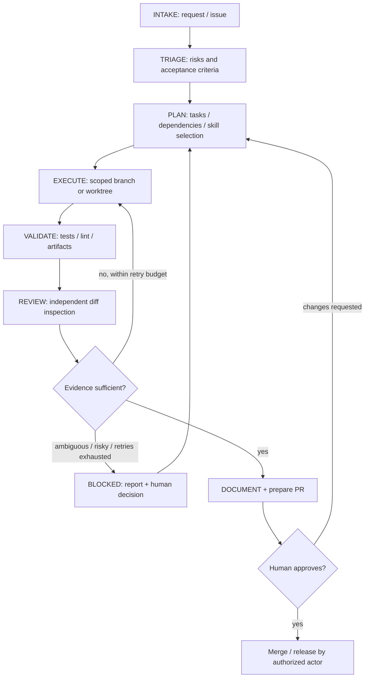

# Development lifecycle (policy, not a background service)

## State contract
| State | Required output | Exit condition |
|---|---|---|
| INTAKE | task brief with source, goal, constraints | problem understood enough to triage |
| TRIAGE | risk level, unknowns, acceptance criteria | high-risk actions identified for approval |
| PLAN | dependency graph, role and skill selections, checks | bounded tasks ready |
| EXECUTE | changed files, commit/diff, notes | working candidate |
| VALIDATE | commands actually run, outputs, gaps | PASS or documented FAIL |
| REVIEW | prioritized findings with file locations | blockers resolved or escalated |
| DOCUMENT | docs/changelog/decision notes and PR | human-readable evidence |
| APPROVAL | approved/rejected/revised decision | merge only on explicit approval |
| BLOCKED | cause, attempts, evidence, options | human or lead resolves assumptions |

## Proportional depth
Small, reversible documentation or formatting edits may follow intake → edit → focused diff check → PR without spawning all specialist roles. Behavior changes, cross-cutting work and security-sensitive changes deserve meaningful tests and independent review. Do not confuse a named review stage in a single session with a separate reviewer.

## Sequencing and parallelism
- Default to sequential for small or coupled work, particularly with cheap models.
- Parallelize read-only research and independent reviews; use separate worktrees for independent writers.
- Merge dependent work in topological order, run integration checks after combining changes, and review the **combined diff**.
- Do not run two agents writing the same file at the same time.
- Each handoff uses [templates/handoff.md](../templates/handoff.md).

## Failure handling
1. Classify failure as requirement ambiguity, code defect, test/environment error, tool/auth failure or safety issue.
2. For a code defect, make at most two meaningful attempts, with evidence after each. No infinite retry loops.
3. Stop immediately for destructive/security/permission ambiguity.
4. If checks cannot run, label NOT RUN and explain why; do not invent success.
5. The human retains the final approval gate.

## Definition of done
Applicable checks passed or limitations explicitly reported; blocking review findings resolved or disclosed; change is minimal, documented and attributable; PR is ready for human review. Skills and roles don't replace repository-specific runbooks.
